# Solana POS — User Manual

A point-of-sale for merchants who accept crypto payments: **Solana**
stablecoins (USDC / USDT) and Thai **PromptPay**. Prices are in your local
currency — Thai baht or US dollar — and QRs convert automatically. Sign in
with just your wallet — no email, no password.

Every required step below has a screenshot. Follow them top to bottom and you
will make your first sale.

---

## Step 1 — Sign in with your wallet

Open the app and connect a Solana wallet (Phantom or Solflare), then sign the
login challenge. That's it — the signature is your login, there is nothing to
remember.

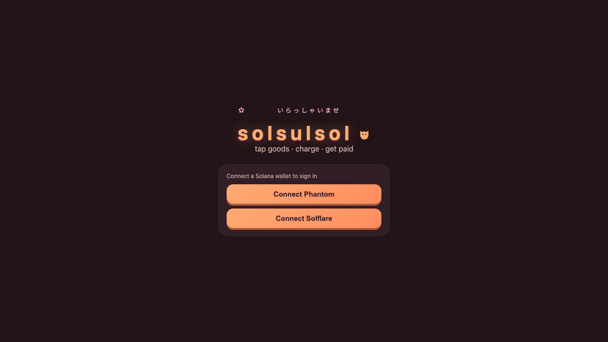

---

## Step 2 — Subscribe (first time only)

The first time you enter, you'll see the subscription gate. Pick a plan:

- **Monthly $1** — or **Yearly $10** (2 months free)
- Includes: 1 shop · 30 goods · 10 MB storage
- If your plan expires you have a 7-day recovery window; after 14 days the
  shop's data is deleted.

Tap **Subscribe** and pay from your wallet.

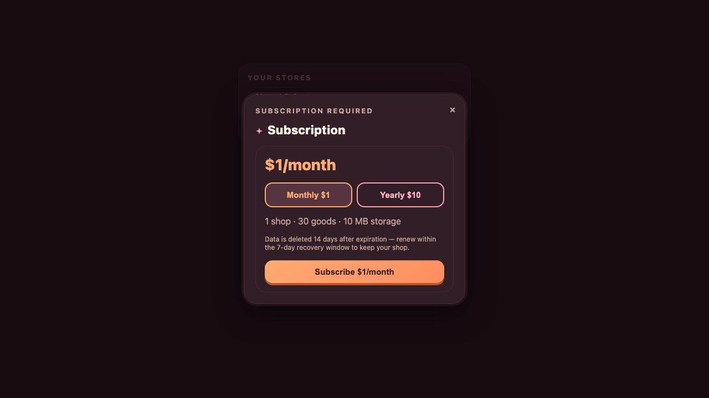

---

## Step 3 — Your dashboard

After signing in you land on the **New sale** screen. The bottom bar switches
between: Sales, Documents, Stats, and Settings.

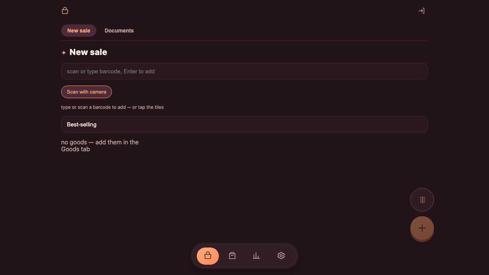

---

## Step 4 — Create your shop

First time only: tap **+ New shop** and give it a name. You can add goods,
stock and payment accounts right after.

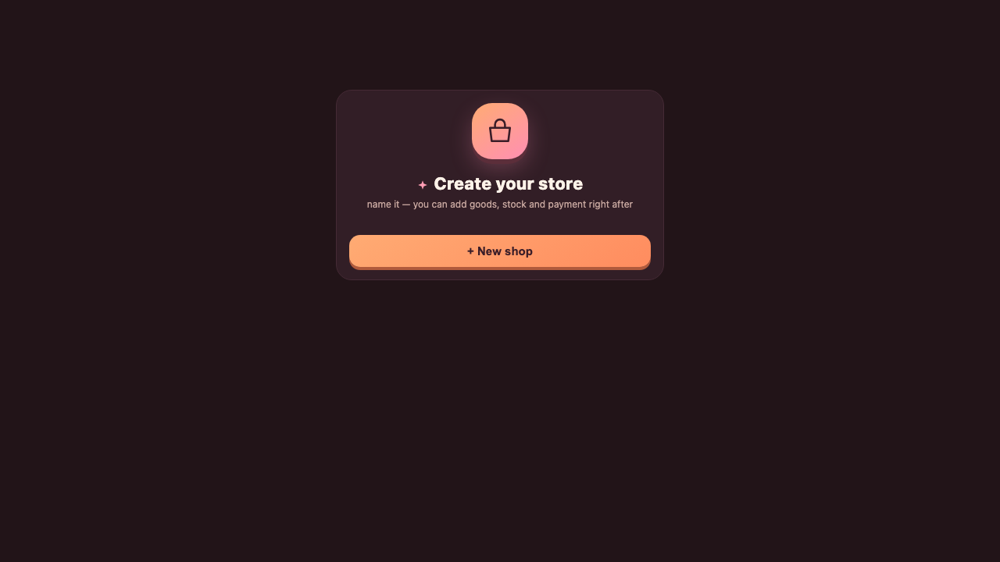

---

## Step 5 — Add your goods

Open the **Goods** tab (second icon in the bottom bar) and add products with a
name, price, cost and barcode. Scan or type the barcode at checkout to add the
item to a sale. Tip: your best-selling items appear as tiles on the sale
screen.

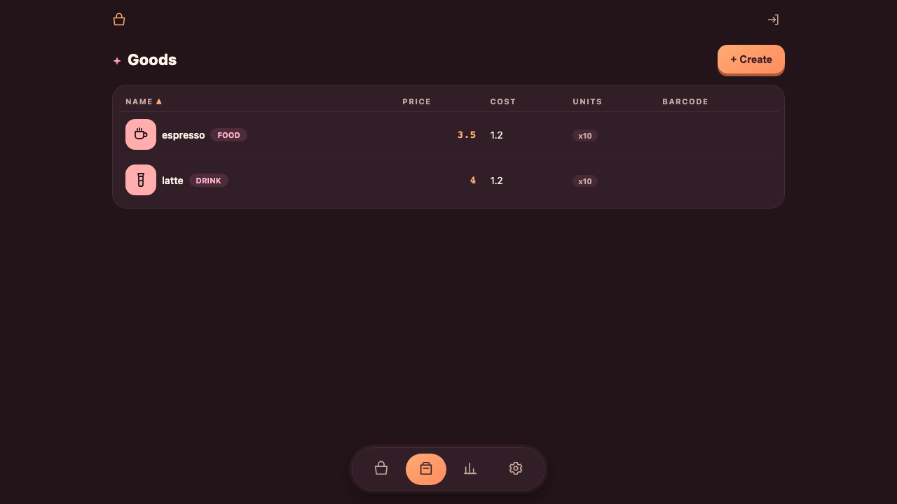

---

## Step 6 — Set where you get paid

Open **Settings → Payments → Receive accounts** and add your wallet
(Solana USDC / USDT) — the account marked **RECEIVES HERE** is where customer
payments land. You can also add a PromptPay ID for Thai QR payments, and your
Tax / VAT details for receipts.

While you're in Settings, set your **swap rate** (THB per $1) in the Tax
section. It converts between baht and stablecoin amounts when a QR is
generated.

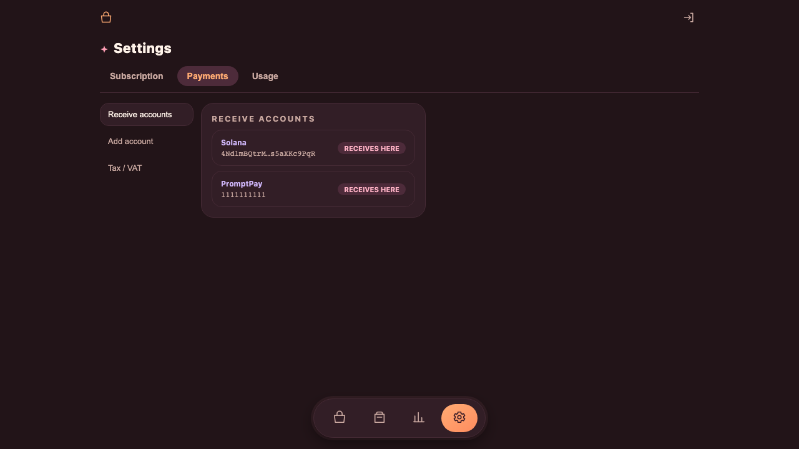

---

## Step 7 — Ring up a sale

On the **New sale** screen, add items by:

- scanning or typing a barcode (press Enter), or
- **Scan with camera**, or
- tapping the best-selling tiles.

Tap the total to charge. The **Choose payment** dialog appears — pick the
wallet or payment type for this sale. Each tile shows the exact amount that
method will collect (฿ for PromptPay, USDC / USDT for Solana).

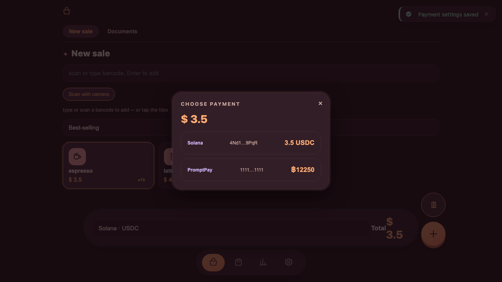

---

## Step 8 — Customer pays the QR

A billing screen shows the amount and a QR code with a 5-minute countdown.
The customer scans and pays with their wallet (Solana Pay) or banking app
(PromptPay). You can also **Download PDF** to print the bill.

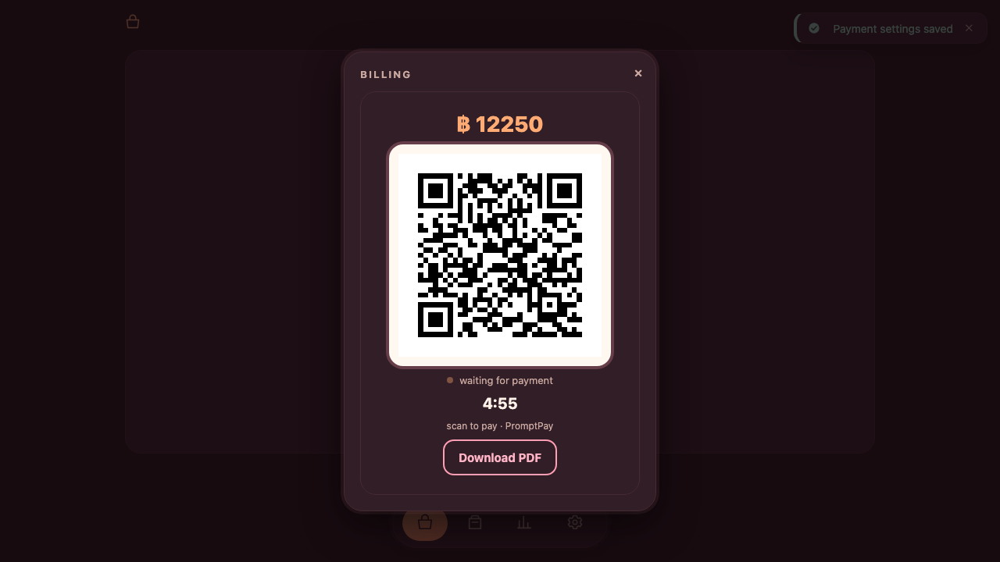

Example QR types supported:

| Solana (USDC) | PromptPay (THB) |
|---|---|
| 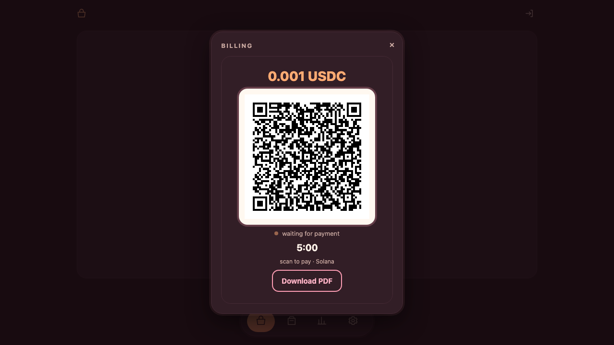 | 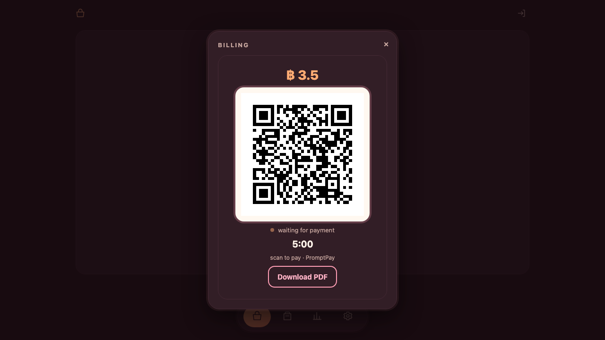 |

PromptPay QRs are always in baht; Solana QRs carry the USDC / USDT amount
(converted with your swap rate when your prices are in THB).

---

## Step 9 — Sale recorded

The backend verifies PromptPay/bank transfers and on-chain transactions. Every
sale is recorded with its revenue and margin in **Reports**, and kept as a
document you can reopen or re-download as a PDF any time.

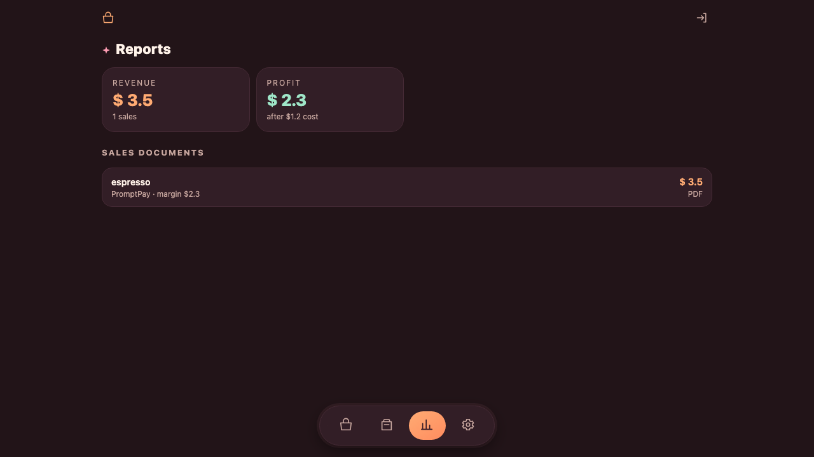

---

## Daily use in 10 seconds

1. Open the app (wallet sign-in, Step 1).
2. Scan goods → charge → show QR (Steps 7–8).
3. The sale lands in Reports (Step 9); money reaches your receive account
   (Step 6).

## Troubleshooting

| Problem | What to do |
|---|---|
| "Subscription required" appears | Renew in Step 2. You have 7 days after expiry to recover data. |
| Wrong payment destination | Check **Settings → Payments → Receive accounts** (Step 6). |
| QR expired | The QR is valid 5 minutes — tap charge again to generate a new one. |
| Payment not confirmed | The on-chain check failed (wrong amount/destination). Ask the customer to retry with the exact amount. |

---

*More for developers: system design docs in [`docs/`](../docs/), agent rules in
[`AGENTS.md`](../AGENTS.md).*
